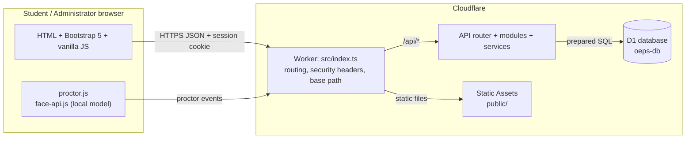
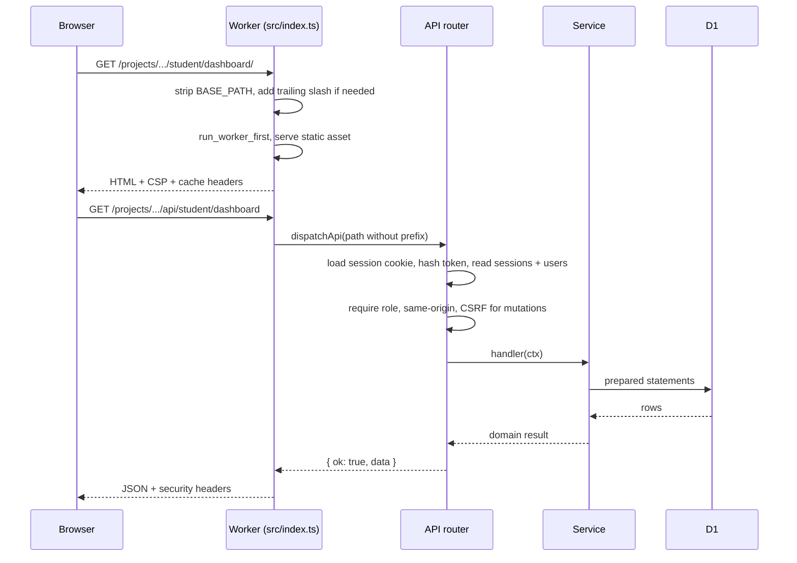
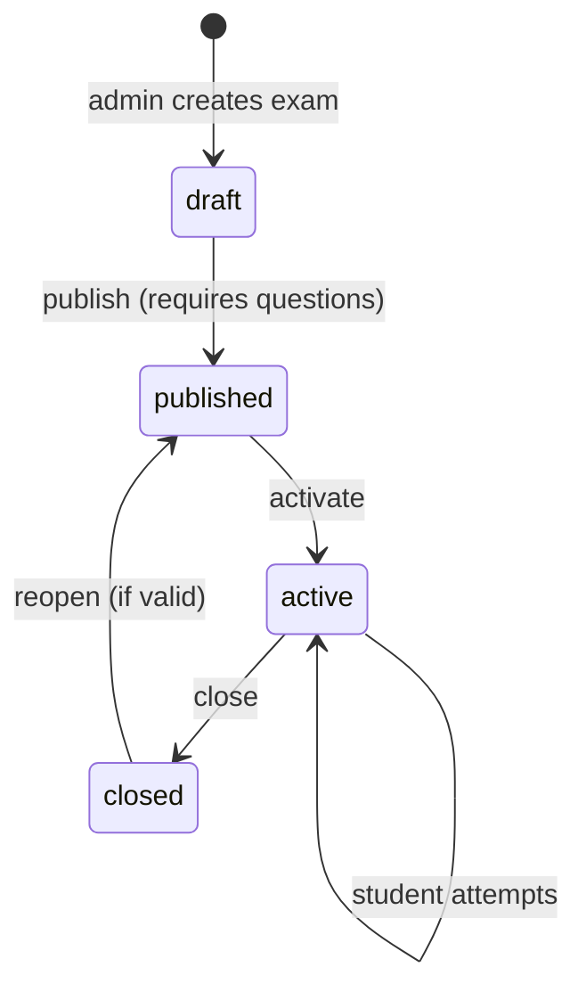

# Architecture

## 1. System context

The Worker is the only application server. There is no separate API host, database server or
client-side framework. All evaluation, authorisation and timing decisions happen server-side.

## 2. Request lifecycle

Unknown API routes return `{ "ok": false, "error": { "code", "message" } }`. Static 404s use the
branded `public/404.html` with a `<base>` rewritten to the deployment prefix.

## 3. Routing and base path

- `BASE_PATH` is stripped from `url.pathname` before any routing. It is
  `/projects/online-examination-and-proctoring-system` in production and empty in local `.dev.vars`.
- Requests outside the prefix return `404` and never reach portfolio content.
- `BASE_PATH` without a trailing slash redirects `308` to `BASE_PATH/`.
- Directory URLs without a trailing slash redirect `308` to the slash form, so relative `<base href>`
  tags resolve correctly.
- `public/index.html` and `public/404.html` use `<base href="./">`; two-level pages use
  `<base href="../../">`.
- Legacy spaced/case URLs (`/projects/Online%20Examination%20and%20Proctoring%20System/...`)
  redirect `308` to the canonical lowercase prefix. The Worker must receive that legacy path, so a
  separate Cloudflare route has to be attached if old links must resolve (see deployment guide).
- `assets.run_worker_first` is enabled so Worker routing and headers are deterministic for every
  request under the route.

## 4. Authentication and sessions

| Control | Implementation |
| --- | --- |
| Password hashing | PBKDF2-SHA256, 100,000 iterations, 16-byte random salt, stored as `pbkdf2$sha256$...` |
| Session cookie | `oeps_session`, random 32-byte hex token, `HttpOnly`, `SameSite=Lax`, `Path=/`, `Secure` when `APP_ENV=production` |
| Stored session | Only `SHA-256(token)` becomes `sessions.id`; CSRF token and expiry are stored with it |
| Lifetime | 12 hours standard, 720 hours with “Remember me” (configurable) |
| Revocation | Logout, password change (other sessions), deactivation and expiry delete sessions |
| CSRF | Session-bound token in `X-CSRF-Token` for mutating requests, plus `Origin` equality |
| Rate limits | Registration 10/hour/IP; login 20/10 min per role+IP; password change 10/hour/user |
| RBAC | Route-level `auth: 'student' \| 'admin'` checked in the Worker |

The rate limiter is stored in Worker-isolate memory. Cloudflare may run several isolates, so it is
a practical deterrent rather than a global quota. A production-scale deployment could move the
bucket to Durable Objects or D1.

## 5. Examination lifecycle

Student attempt flow:

1. Student opens an active exam inside its window and accepts the consent statement.
2. `POST /api/student/exams/:id/start` checks role, exam window, questions and existing attempt.
3. The server sets `expires_at = min(now + duration, exam.end_time)` and stores it. The browser
   timer is a display aid only.
4. Answers are saved with `PUT /api/student/attempts/:id/answers/:questionId` after each change.
   The attempt payload deliberately omits `is_correct`.
5. `POST /api/student/attempts/:id/submit` evaluates from the database. An 8-second network grace
   period allows an in-flight submission around the deadline.
6. A conditional `UPDATE ... WHERE status = 'in_progress'` plus a `UNIQUE` result row makes
   duplicate submission idempotent: the second request returns the existing result with
   `alreadySubmitted: true`.
7. Expired attempts are finalised lazily on student read paths (`finalizeExpiredAttempts`), so
   closing the browser does not leave attempts open.
8. Results are stored but hidden until the administrator sets `results_published` on the exam.

Evaluation rules: one mark total per question if the selected option equals the database's correct
option; total marks are summed from the question bank, never from client input; pass when
`obtained_marks >= passing_marks` and at least one question exists.

## 6. Proctoring design

| Signal | Source | Severity | Server behaviour |
| --- | --- | --- | --- |
| `NO_FACE_DETECTED` | Tiny Face Detector, 2 consecutive misses / 20 s cooldown | medium | 10 s per-type cooldown, max 500 events per attempt |
| `MULTIPLE_FACES_DETECTED` | Face detector count > 1 | high | as above |
| `CAMERA_DISCONNECTED` | `MediaStreamTrack` ended / stream failure | high | as above |
| `TAB_SWITCH` | Page Visibility API | medium | as above |
| `WINDOW_BLUR` | `window.blur` | low | as above |
| `FULLSCREEN_EXIT` | Fullscreen API change | medium | as above |

- Consent is required server-side (`consent_given`) before an attempt starts.
- The face model is bundled locally; no video or image is uploaded or stored.
- The camera track is stopped when the attempt page is left or submitted.
- Every event has a review state (`unreviewed`, `reviewed`, `dismissed`) for the administrator.
- Limitations are explicit: the browser cannot see other operating-system applications, physical
  devices or people entirely outside the camera frame. Signals are not proof of misconduct.

## 7. Source map

| Path | Responsibility |
| --- | --- |
| `src/index.ts` | Worker entry, prefix handling, legacy redirects, static serving, security headers |
| `src/router.ts` | Regex path matching, auth gates, CSRF/origin checks, error envelope |
| `src/config/environment.ts` | `BASE_PATH`, production flag, session TTL, submission grace |
| `src/middleware/*` | Session loading, role checks, CSRF, rate limit, field validation |
| `src/modules/*` | HTTP routes grouped by domain |
| `src/services/*` | Business rules and SQL |
| `public/assets/js/app.js` | Shared UI shell, API client, guards, modals, formatting |
| `public/assets/js/proctor.js` | Consent, camera, face detection, visibility/fullscreen events |
| `scripts/create-admin.mjs` | Local/remote administrator creation with PBKDF2 hashing |
| `tests/integration.mjs` | 30-group API end-to-end suite |
| `tests/subpath.mjs` | Deployment-shape suite with the production prefix |

## 8. API reference

All JSON responses use `{ ok: true, data }` or `{ ok: false, error: { code, message, fields? } }`.
Mutating requests require `X-CSRF-Token` and a same-origin `Origin` header.

| Method | Path | Access | Purpose |
| --- | --- | --- | --- |
| GET | `/api/health` | public | Liveness probe |
| GET | `/api/auth/session` | public | Current user + CSRF token |
| POST | `/api/auth/register` | public | Student registration |
| POST | `/api/auth/login` | public | Student login |
| POST | `/api/auth/admin/login` | public | Administrator login |
| POST | `/api/auth/logout` | session | Revoke current session |
| POST | `/api/auth/change-password` | session | Change password, revoke other sessions |
| PATCH | `/api/auth/profile` | session | Update own profile |
| GET | `/api/admin/dashboard` | admin | Statistics, charts, recent events |
| GET | `/api/admin/students` | admin | Search/filter students |
| GET | `/api/admin/students/:id` | admin | Student detail and attempts |
| PATCH | `/api/admin/students/:id` | admin | Activate/deactivate account |
| GET | `/api/admin/exams` | admin | List examinations |
| POST | `/api/admin/exams` | admin | Create draft |
| GET | `/api/admin/exams/:id` | admin | Exam, questions, totals |
| PATCH | `/api/admin/exams/:id` | admin | Edit, publish, activate, close |
| DELETE | `/api/admin/exams/:id` | admin | Safe delete (attempts checked) |
| GET | `/api/admin/exams/:id/attempts` | admin | Attempts for an exam |
| PATCH | `/api/admin/exams/:id/results-publish` | admin | Release/hide results |
| GET | `/api/admin/questions` | admin | Question bank |
| POST | `/api/admin/exams/:id/questions` | admin | Add question (four options, one correct) |
| POST | `/api/admin/exams/:id/questions/reorder` | admin | Reorder questions |
| PATCH | `/api/admin/questions/:id` | admin | Edit question |
| DELETE | `/api/admin/questions/:id` | admin | Delete question (unlocked exams only) |
| GET | `/api/admin/results` | admin | Results overview |
| GET | `/api/admin/proctoring` | admin | Proctoring event list |
| PATCH | `/api/admin/proctoring/:id` | admin | Review/dismiss event |
| GET | `/api/student/dashboard` | student | Summary, exams, recent results |
| GET | `/api/student/exams` | student | Available/upcoming/completed exams |
| GET | `/api/student/exams/:id` | student | Exam detail before starting |
| POST | `/api/student/exams/:id/start` | student | Start/resume attempt with consent |
| GET | `/api/student/attempts` | student | Attempt history |
| GET | `/api/student/attempts/:id` | student | Attempt payload without correct answers |
| PUT | `/api/student/attempts/:id/answers/:questionId` | student | Save answer |
| POST | `/api/student/attempts/:id/submit` | student | Submit and evaluate |
| POST | `/api/student/attempts/:id/proctor-events` | student | Record a proctoring signal |
| GET | `/api/student/results` | student | Released results + pending count |

## 9. Trade-offs

- **Workers + D1** keep hosting free-tier friendly and remove server maintenance, at the cost of
  per-isolate rate limiting and no long-running background jobs. Expiry is therefore lazy.
- **Vanilla JS** keeps the bundle small and honours the assignment constraint, but shares no
  component framework; `app.js` provides the shared helpers.
- **Local face model** protects privacy: the model needs no third-party connection, and CSP
  `connect-src` allows only the application origin plus Cloudflare's own analytics endpoint. The
  Tiny Face Detector is intentionally light and can miss faces in poor light.
- **No recordings** reduce privacy risk and storage cost; reviewers see event metadata only.
