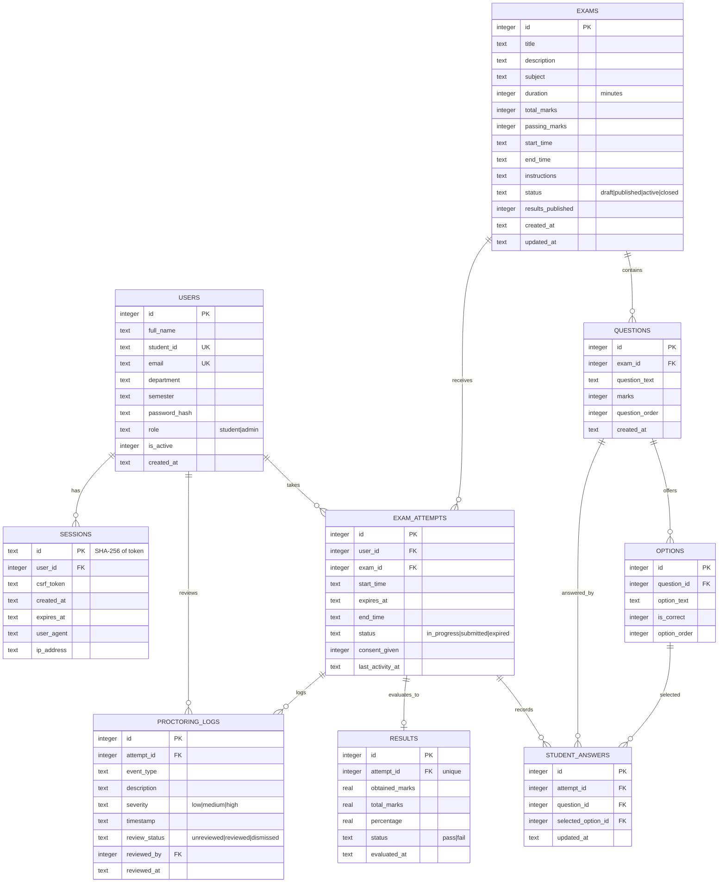

# Database design

Cloudflare D1 (SQLite). The authoritative schema is the versioned migration
`migrations/0001_initial_schema.sql`; `database/schema.sql` is a readable snapshot of the same
statements. All access goes through prepared statements with bound parameters.

## 1. Entity-relationship model



## 2. Tables and constraints

### `users`

- `email` is `UNIQUE COLLATE NOCASE`; `student_id` is nullable and unique (administrators have none).
- `role` is constrained to `student`/`admin`; there is no public administrator registration.
- `is_active` gates login and existing sessions. Deactivation deletes sessions in the same service
  operation.
- `password_hash` stores PBKDF2 metadata and never plaintext.

### `sessions`

- Primary key is the SHA-256 hex digest of the random cookie token, so a leaked database cannot be
  replayed as a cookie.
- `expires_at` is checked on every authenticated request; expired sessions are deleted.
- `ON DELETE CASCADE` from `users` removes sessions with the account.

### `exams`

- `duration > 0`, `total_marks >= 0`, `passing_marks >= 0`, `end_time > start_time` are enforced by
  `CHECK` constraints.
- `status` is constrained; `results_published` is a 0/1 flag separate from status, so results can
  be released or hidden without changing the exam state.
- `total_marks` is maintained from questions during question create/edit/delete, not from client
  input.

### `questions` and `options`

- Questions cascade with their exam and carry `marks > 0` plus an explicit order.
- Options cascade with their question. Application validation enforces exactly four options and
  exactly one correct option, because SQLite cannot express that count constraint declaratively.
- Editing/deleting questions is blocked once an attempt exists, preserving historical fairness.

### `exam_attempts`

- `UNIQUE (user_id, exam_id)` guarantees one attempt per student per exam.
- `expires_at` is the authoritative deadline. Status transitions are guarded by a conditional
  update in evaluation, so only one concurrent submit wins.
- `consent_given` records acknowledgement of proctoring and examination rules.
- `last_activity_at` supports operational review.

### `student_answers`

- `UNIQUE (attempt_id, question_id)` means an answer upsert is idempotent.
- `selected_option_id` uses `ON DELETE SET NULL`; historical answers survive option removal.
- Attempts cascade with deletion of the attempt, but exams with attempts are protected from
  deletion at the service layer.

### `results`

- `attempt_id` is unique, so a second evaluation cannot create a second result.
- Marks are stored as `REAL` with two-decimal percentage rounding in the service.
- `status` is `pass`/`fail`; the result row is created at submission but only exposed to students
  when `exams.results_published = 1`.

### `proctoring_logs`

- Event metadata only: no images, audio or video.
- `severity` and `review_status` are constrained.
- `reviewed_by` uses `ON DELETE SET NULL` so a removed reviewer does not erase the event.
- Indexed by attempt/time, review state and event type for administrator filtering.

## 3. Indexes

| Index | Supports |
| --- | --- |
| `idx_users_role`, `idx_users_active` | Admin student filters and login |
| `idx_sessions_user`, `idx_sessions_expires` | Session lookup/cleanup |
| `idx_exams_status`, `idx_exams_start`, `idx_exams_end` | Student listing and scheduling |
| `idx_questions_exam` | Ordered question loading |
| `idx_options_question` | Option loading |
| `idx_attempts_user`, `idx_attempts_exam`, `idx_attempts_status` | Dashboards, results, lazy expiry |
| `idx_answers_attempt` | Restore and evaluation |
| `idx_results_status` | Result dashboards |
| `idx_proctor_attempt`, `idx_proctor_review`, `idx_proctor_type` | Proctoring review screen |

## 4. Time handling

Every timestamp is an ISO-8601 UTC string (`YYYY-MM-DDTHH:MM:SS.sssZ`). This makes lexicographic
comparison equal to chronological comparison and avoids timezone ambiguity between the Worker and
D1. A deadline comparison is always repeated server-side; client clocks are never trusted.

## 5. Data lifecycle

1. Exam created → `draft`; questions added; totals recomputed.
2. Publish requires at least one question and valid schedule; activate opens attempts.
3. Student start creates one attempt with a server-computed `expires_at`.
4. Answers upsert during the attempt.
5. Submit (or first read after the grace deadline) creates one immutable result row.
6. Admin releases results; students then see marks and pass/fail.
7. Deletion of an exam is refused when attempts exist. Attempts cascade answers, results and
   proctoring logs only through explicit database cascades, not through normal UI flows.

## 6. Migration workflow

```bash
# Local
npm run db:migrate:local

# Remote (after creating the D1 database and setting database_id)
npm run db:migrate:remote
```

To add a migration, create `migrations/0002_<description>.sql`, apply it locally and remotely, then
update `database/schema.sql`. Never edit an applied migration in place on a shared database.
