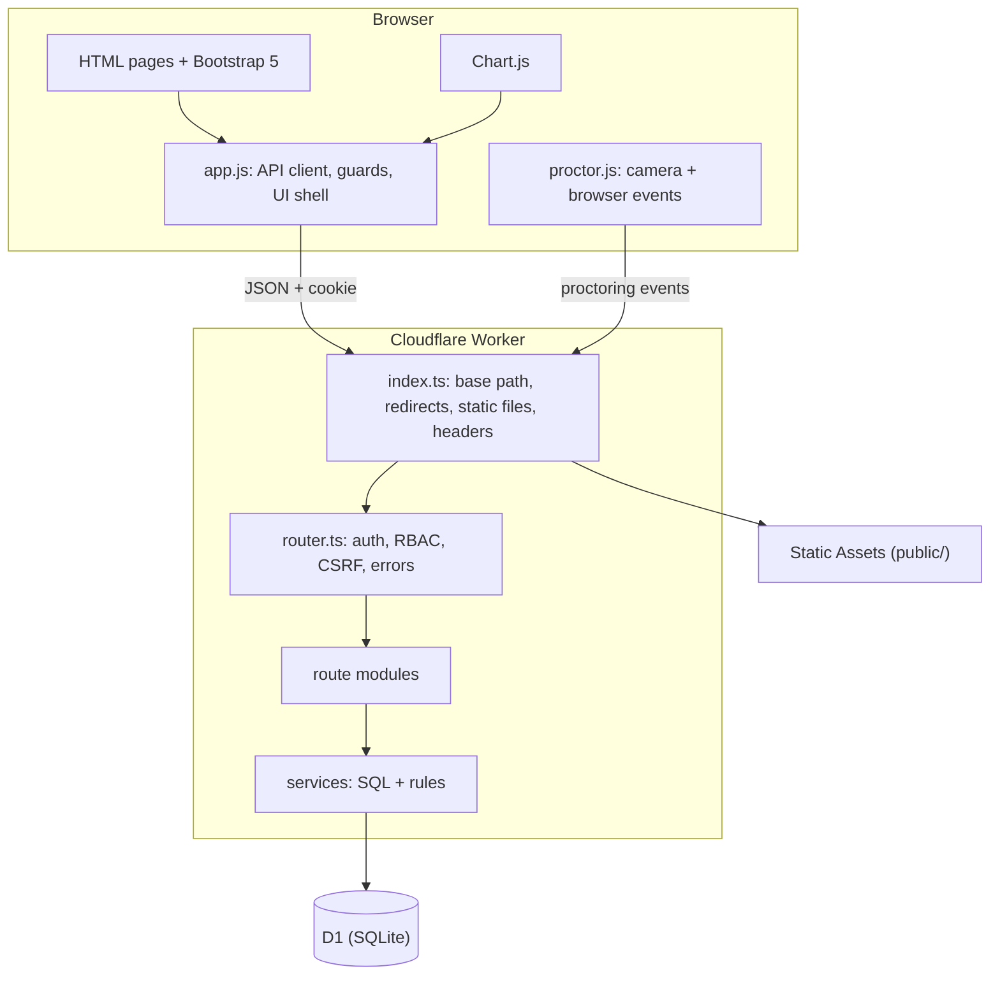
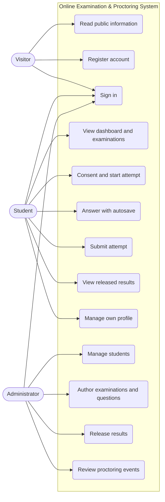
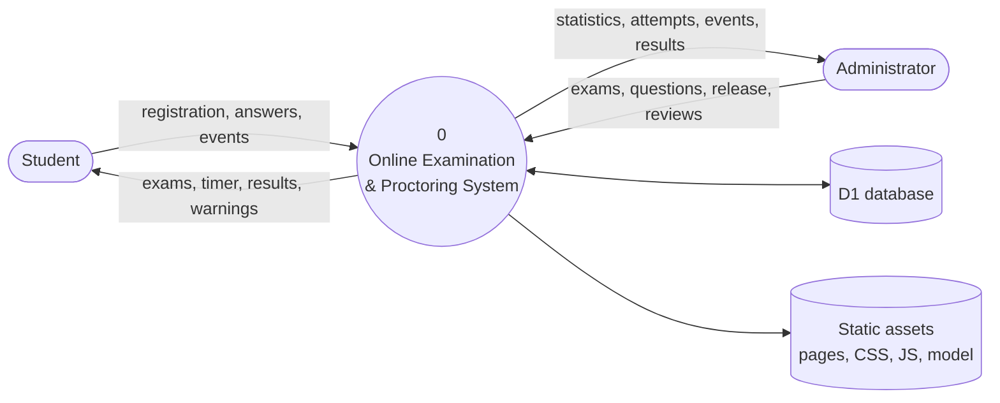
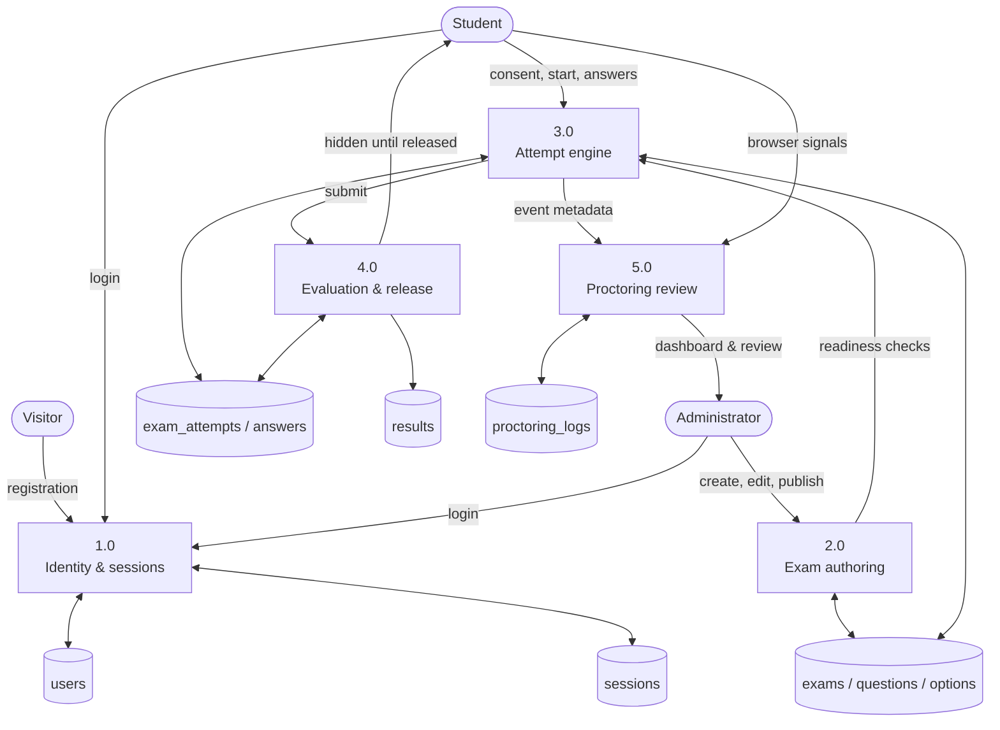
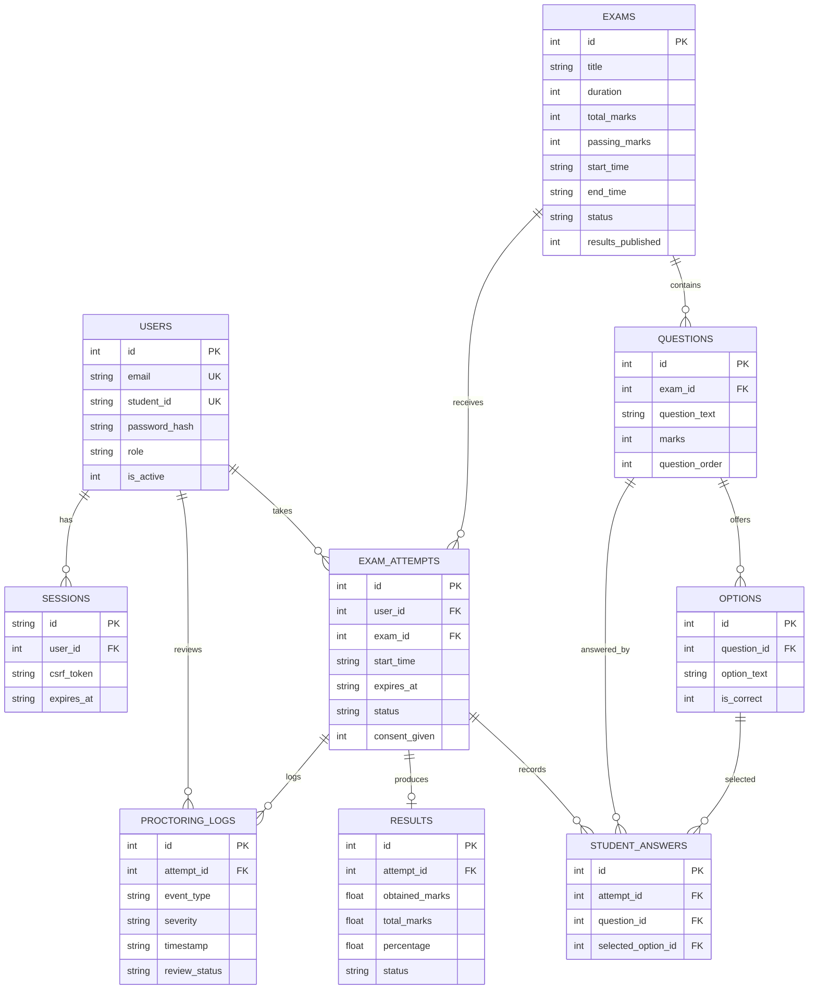
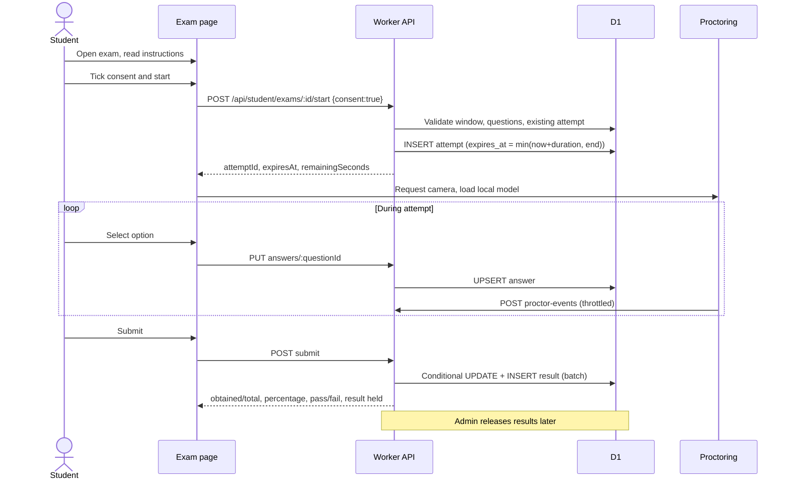

# Online Examination and Proctoring System

### Project report

**Author:** Rishav Prasad
**Date:** 31 October 2026
**Live URL:** `https://rishavprasad.in/projects/online-examination-and-proctoring-system/`

---

## Abstract

Educational institutions need a dependable way to conduct timed examinations online without
assuming that every student is supervised in the same room. This project implements a complete
examination portal that combines account management, examination authoring, server-authoritative
timing, automatic evaluation and browser-based proctoring signals. Students register with their
college identity, read instructions, explicitly consent to monitoring, attempt an examination under
a server-controlled clock and receive results only after an administrator releases them.
Administrators manage students, examinations and questions, review proctoring events and publish
results.

The system is built as a TypeScript Cloudflare Worker with a D1 (SQLite) database and a static
HTML5/CSS3/JavaScript frontend using Bootstrap 5, Bootstrap Icons and Chart.js. It uses the Royal
Bengal visual identity — ivory, royal brown, maroon and antique gold — with self-hosted Inter and
Playfair Display fonts. It is mounted under a portfolio sub-directory without altering the
portfolio itself. Automated verification recorded 30 of 30 API integration groups and 10 of 10
deployment-shape checks passing in local Wrangler mode. It was deployed to the production Cloudflare
account on 31 October 2026 at the live URL below; a production smoke test covered the prefix
redirect, home page, API health, administrator login and dashboard, cookie flags and an unchanged
portfolio root.

---

## Table of contents

1. [Introduction](#1-introduction)
2. [Requirements analysis](#2-requirements-analysis)
3. [Technology and design rationale](#3-technology-and-design-rationale)
4. [System design](#4-system-design)
5. [Implementation](#5-implementation)
6. [Security, privacy and fairness](#6-security-privacy-and-fairness)
7. [Testing and results](#7-testing-and-results)
8. [Deployment](#8-deployment)
9. [Limitations and future scope](#9-limitations-and-future-scope)
10. [Conclusion](#10-conclusion)
11. [References](#11-references)

---

## 1. Introduction

### 1.1 Background

In-person invigilation does not scale to every assessment, and purely offline question papers are
slow to evaluate. A web portal can remove paper handling and manual marking, but it introduces new
problems: unreliable client clocks, duplicate submissions, exposed answer keys, lost answers after a
refresh and the temptation to switch tabs during an examination. A credible system therefore has to
treat the server, not the browser, as the source of truth.

### 1.2 Problem statement

Build an integrated online examination and proctoring system in which:

- students can register, sign in and attempt scheduled examinations;
- every attempt is timed and evaluated by the server;
- administrators can author examinations and questions, monitor attempts and release results;
- browser-observable proctoring signals are recorded for human review, with consent and clear
  limitations;
- the whole application is reachable under a portfolio sub-path without affecting the portfolio.

### 1.3 Objectives

1. Provide a public information page and an authenticated student portal.
2. Enforce authentication, role-based access and secure session handling.
3. Implement examination authoring with multiple-choice questions, four options and one correct
   answer.
4. Implement a timed attempt engine with autosave, restore, duplicate-submission protection and
   server-side evaluation.
5. Record configurable proctoring signals without storing camera recordings.
6. Provide an administrator dashboard with real database statistics and Chart.js visualisations.
7. Deploy safely under a sub-directory with a canonical lowercase URL.
8. Verify behaviour honestly through automated API and deployment-shape tests.

### 1.4 Scope

In scope: student and administrator web flows, examination and question management, attempts,
evaluation, result release, proctoring event capture and review, local and remote deployment
configuration, database migrations and documentation.

Out of scope for this version: institutional single sign-on, question types other than
single-answer multiple choice, live video streaming, automated disciplinary decisions, native
mobile applications, email notifications and multi-tenant administration.

---

## 2. Requirements analysis

### 2.1 Stakeholders

| Stakeholder | Interest |
| --- | --- |
| Student | Reliable access to scheduled examinations, clear timing, preserved answers, timely results |
| Administrator / examiner | Easy authoring, accurate live statistics, review of monitoring signals, control over result release |
| Institution | Fair evaluation, audit trail, low operating cost, privacy-aware monitoring |
| Portfolio owner | The project must not disturb other pages, DNS or existing hosting |

### 2.2 Functional requirements

| ID | Requirement |
| --- | --- |
| FR-01 | The public home page is accessible without authentication |
| FR-02 | Students register with name, student ID, email, department, semester and password |
| FR-03 | Students sign in with email **or** student ID; administrators use a separate login |
| FR-04 | No public administrator registration exists |
| FR-05 | Sessions expire, can be revoked and are protected against CSRF |
| FR-06 | Students see available, upcoming, ongoing, completed and ended examinations |
| FR-07 | An examination detail page shows schedule, duration, marks and instructions |
| FR-08 | Consent is required before an attempt starts |
| FR-09 | Only one attempt per student per examination is possible |
| FR-10 | The timer is enforced by the server; late submissions use a small grace window |
| FR-11 | Answers save automatically and restore after reload |
| FR-12 | Submission is idempotent; evaluation uses stored answers and stored marks |
| FR-13 | Results stay hidden until the administrator releases them |
| FR-14 | Administrators see live counts and charts on the dashboard |
| FR-15 | Administrators manage students, including deactivation and reactivation |
| FR-16 | Administrators create, edit, publish, activate, close and safely delete examinations |
| FR-17 | Questions have exactly four options, exactly one correct answer, marks and order |
| FR-18 | Questions cannot be edited after attempts exist |
| FR-19 | Proctoring events are recorded with severity, timestamp and review state |
| FR-20 | Administrators can review or dismiss proctoring events |
| FR-21 | Profile and password can be updated; a password change revokes other sessions |
| FR-22 | The app works under the configured sub-path with canonical redirects |

### 2.3 Non-functional requirements

| ID | Requirement |
| --- | --- |
| NFR-01 | Responsive layout for desktop, tablet and mobile |
| NFR-02 | Royal Bengal identity, consistent typography and accessible contrast |
| NFR-03 | Parameterised SQL only; no string concatenation of user input |
| NFR-04 | Strict TypeScript; no implicit any |
| NFR-05 | Passwords hashed with a slow KDF and per-user salt |
| NFR-06 | Security headers including CSP, frame denial, nosniff and a restrictive permissions policy |
| NFR-07 | Server-authoritative timing independent of the client clock |
| NFR-08 | Privacy: no camera recordings by default |
| NFR-09 | Clear disclosure that proctoring signals are not proof of misconduct |
| NFR-10 | Deployment confined to the project prefix; portfolio unaffected |
| NFR-11 | Versioned schema migrations and a schema snapshot |
| NFR-12 | Tests executable locally with documented results |

### 2.4 Constraints

- Frontend: HTML5, CSS3, vanilla JavaScript, Bootstrap 5, Bootstrap Icons, Chart.js.
- Backend: TypeScript on Cloudflare Workers; database: D1.
- No Flask, Django, PHP, MySQL, MongoDB, Firebase, Supabase, Render, Railway or Vercel.
- No hardcoded administrator credentials and no committed secrets.
- No invented account IDs, database IDs or successful test results.
- No automatic nameserver, DNS or portfolio configuration changes.

---

## 3. Technology and design rationale

### 3.1 Cloudflare Workers and D1

Workers provide a managed, low-latency runtime with static asset hosting and a SQL database in the
same platform. For a college-scale examination portal this avoids running a separate application
server and database host. The price is a restricted runtime and per-isolate state, which influenced
two design decisions: expiry is finalised lazily on read, and the rate limiter is a practical
deterrent rather than a global quota.

### 3.2 TypeScript and a custom router

Strict TypeScript catches shape mistakes across route handlers and services. The router is a small
ordered table of method/path/handler entries with `:param` matching. This is sufficient for the API
surface, keeps the cold start small and makes authorisation and CSRF checks uniform in one place.

### 3.3 Vanilla frontend

Bootstrap supplies layout and form primitives; Bootstrap Icons supply iconography; Chart.js draws
the dashboard charts. A shared `app.js` provides API calls, session guards, navigation shells,
modals and formatting. Avoiding a client framework keeps the JavaScript small and satisfies the
assignment constraint.

### 3.4 face-api.js with a local model

The Tiny Face Detector from face-api.js runs entirely in the browser. The model files are served
from the application origin, so no third-party connection is needed; the Content Security Policy's
`connect-src` permits only the application origin and Cloudflare's own analytics endpoint. Only
derived event metadata leaves the browser. This is a deliberate privacy trade-off: no video, no
images, lower detection fidelity.

### 3.5 Royal Bengal design system

| Token | Value | Use |
| --- | --- | --- |
| `--ivory` | `#f5f0e6` | Page background |
| `--royal-brown` | `#68452f` | Primary brown surfaces |
| `--deep-brown` | `#432b20` | Headings and dark surfaces |
| `--royal-maroon` | `#762d3f` | Primary actions and accents |
| `--antique-gold` | `#b58a45` | Highlights and dividers |
| `--cream-white` | `#fffcf6` | Cards |
| Inter | Variable sans | Body and UI |
| Playfair Display | Variable serif | Selective headings and scores |

Fonts are self-hosted under `public/assets/fonts/` with their SIL Open Font License files. The
palette avoids generic blue SaaS styling, neon and heavy gradients.

---

## 4. System design

### 4.1 Architecture



The Worker is stateless apart from D1 and the per-isolate rate limiter. The browser holds only the
session cookie and the CSRF token.

### 4.2 Use case diagram



### 4.3 Data flow — context (level 0)



### 4.4 Data flow — level 1



### 4.5 Entity-relationship model



The full column list, checks and indexes are in [database-design.md](database-design.md).

### 4.6 Attempt sequence



### 4.7 Interface design

- Public home: hero, 13 instructions, 7-step workflow, 8 feature cards, about, privacy disclosure,
  footer with dynamic year.
- Authentication pages: split layout with brand aside and a clear form; student and administrator
  logins are visually distinct but share the design system.
- Student portal: top navigation, summary cards, examination badges, a focused attempt layout with
  a sticky timer, question palette, warning banners and submit confirmation.
- Administrator console: fixed sidebar, top bar, statistic cards, Chart.js panels, tables with
  filters and modals for create/edit/review actions.
- Accessibility: skip link, visible focus, semantic headings, labelled controls, reduced-motion
  support in CSS where relevant.

---

## 5. Implementation

### 5.1 Repository structure

```text
src/index.ts               Worker entry and static serving
src/router.ts              route dispatch, auth gates, CSRF/origin checks
src/modules/*              HTTP route modules
src/services/*             business logic and SQL
src/middleware/*           session, RBAC, CSRF, rate limiting, validation
public/                    static pages, assets, face model, fonts
migrations/                versioned D1 schema
database/schema.sql        schema snapshot
scripts/create-admin.mjs   administrator CLI
tests/                     API and sub-path suites
docs/                      this report and operating documents
```

### 5.2 Authentication and sessions

Registration validates names, student ID format, email, department, semester and password strength.
Login accepts an email or student ID and compares the password with PBKDF2-SHA256 using 100,000
iterations. A successful login creates a random 32-byte token; the database stores only its SHA-256
hash along with the user, CSRF token and expiry. The cookie is `HttpOnly`, `SameSite=Lax`,
`Path=/`, and `Secure` when `APP_ENV=production`.

Every authenticated request loads the session join and rejects expired or inactive accounts.
Mutating requests additionally require a same-origin `Origin` and the `X-CSRF-Token` header. Login,
registration, logout and profile updates have explicit CSRF exceptions only where no session exists
or the operation is itself a revocation.

### 5.3 Examination authoring

An examination starts as a draft with a validated schedule and passing marks. Adding or editing a
question updates the exam's total marks in the same operation. Publishing requires at least one
question and a passing mark not above the total. State transitions are validated: draft →
published → active → closed, with reopening where consistent. Questions and options cannot be
changed once any attempt exists, preserving the fairness of submitted answers.

### 5.4 Attempt engine

- Start validates role, exam status, schedule window, question count and existing attempt.
- `expires_at` is `min(start + duration, exam end)`; the client timer is cosmetic.
- Answer saves are upserts keyed by attempt and question; the attempt payload never includes
  `is_correct`.
- Submission (and lazy expiry) evaluates from the database and writes one result via a batched
  conditional update and unique insert.
- A duplicate submission returns the existing result instead of evaluating again.
- The 8-second grace period allows a request that began before the deadline to finish.

### 5.5 Proctoring

`proctor.js` requests camera access, loads the local Tiny Face Detector, and samples frames. It
emits no-face events after two consecutive misses and applies a 20-second client cooldown.
Visibility changes, window blur and fullscreen exit produce their own events. The server enforces a
10-second per-type cooldown and a 500-event cap, and rejects events for closed or expired attempts.
Warnings are shown in the UI. Tracks stop when the attempt ends or the page is left.

### 5.6 Administrator console

The dashboard aggregates students, exams, attempts, results and proctoring events in SQL and
returns chart-ready series. Student management supports search and filters, detail inspection and
account activation. Exam and question screens share validation rules with the API. Proctoring
reports support filtering and review state. Result release is an explicit action separate from
attempt submission.

### 5.7 Sub-path deployment

`BASE_PATH` is stripped before API or static routing. The Worker redirects the prefix without a
trailing slash, and directory paths without a slash, to canonical slash forms. Static 404 pages get
their `<base>` rewritten to the deployment prefix. A legacy spaced/mixed-case prefix redirects to
the canonical lowercase prefix. `assets.run_worker_first` makes Worker routing deterministic.
Requests outside the prefix return `404`, so the portfolio is never served through this Worker.
Details and the exact Cloudflare route procedure are in [deployment-guide.md](deployment-guide.md).

---

## 6. Security, privacy and fairness

| Area | Control |
| --- | --- |
| Password storage | PBKDF2-SHA256, 100,000 iterations, random salt |
| Session storage | SHA-256 of the token only; expiry and revocation |
| Cookie | HTTP-only, SameSite=Lax, Secure in production |
| CSRF | Session-bound header + same-origin check |
| Authorisation | Worker-side role checks on every protected route |
| SQL | Prepared statements and bound parameters |
| Input validation | Shared field validators with explicit limits |
| Rate limiting | Registration, login and password change buckets |
| Headers | CSP, `X-Frame-Options: DENY`, nosniff, referrer policy, permissions policy |
| Data minimisation | Proctoring stores metadata only; no recordings by default |
| Consent | Required and recorded before an attempt starts |
| Honest reporting | Test results recorded from actual runs; limitations documented |

Fairness considerations are part of the functional design, not an afterthought. The interface states
that a detected event is not automatic proof of misconduct. Administrators can dismiss events, and
no automated penalty is applied. The system openly documents that browser monitoring cannot observe
other applications, physical devices or off-camera assistance. Face detection can produce false
positives in poor light, with face coverings or unusual camera angles.

---

## 7. Testing and results

### 7.1 Automated verification

| Suite | Scope | Result |
| --- | --- | --- |
| `npm run typecheck` | Strict TypeScript build check | Passed, no errors |
| `npm test` | 30 API integration groups against a live local Worker + D1 | 30/30 passed |
| `npm run test:subpath` | 10 deployment-shape checks with the production prefix | 10/10 passed |

The API suite covers registration, duplicate registration, hardened cookie attributes, CSRF and
origin rejection, RBAC, exam drafting and readiness, question constraints, consent, single-attempt
creation and resume, hidden correct answers, answer persistence, proctoring cooldown, server
evaluation, idempotent submission, hidden results, release, profile updates, password change
revocation, deactivation and rate limiting. The sub-path suite covers prefix redirects, static
assets and fonts, nested base tags, branded 404 rewrite, legacy spaced URLs, API under the prefix
and portfolio-path isolation.

### 7.2 Manual browser walkthrough

A Chromium walkthrough covered publish → activate → register → consent → start → autosave and
reload → tab/window warnings → submit → review proctoring → release results → student result view.
Camera denial was handled gracefully with a visible fallback. All exercised scenarios behaved as
intended.

### 7.3 What was not tested

Production deployment itself was completed, but load, failover and long-running TLS/route
propagation beyond the smoke test were not benchmarked. Concurrency beyond duplicate submission was
not tested. Face-detection accuracy with varied lighting and multiple people was not measured.
Cross-browser behaviour was limited to Chromium. The rate limiter is per isolate and not a global
quota. Full details and reproduction commands are in [test-cases.md](test-cases.md).

---

## 8. Deployment

The application is live at
`https://rishavprasad.in/projects/online-examination-and-proctoring-system/`. The deployment
sequence that was executed:

1. Authenticate Wrangler with the operator's Cloudflare account (OAuth).
2. Create the D1 database `oeps-db` and write its non-secret ID into `wrangler.jsonc`.
3. Apply `0001_initial_schema.sql` to the remote database.
4. Create the administrator through the CLI; the password was generated and stored only as a hash.
5. Deploy the Worker with the exact prefix and wildcard routes in `wrangler.jsonc`.
6. Resolve route ownership: the older `vidya-suraksha` Worker held the wildcard route; it was
   unassigned and the new Worker became the owner. The old Worker was not deleted.
7. Verify the prefix `308`, home `200`, API health, admin login cookie flags, authenticated
   dashboard and the unchanged `rishav-portfolio` root.

No nameserver or DNS record was changed. The Worker only answers the project prefix and returns
`404` elsewhere. The complete procedure, including rollback and troubleshooting, is in
[deployment-guide.md](deployment-guide.md).

---

## 9. Limitations and future scope

### Limitations

- Browser proctoring cannot see other operating-system applications, physical devices, screen
  sharing or people entirely outside the camera frame.
- The Tiny Face Detector is lightweight and can miss or over-count faces in difficult conditions.
- The in-memory rate limiter is per isolate; a global quota needs a shared store.
- Attempt expiry is finalised lazily on read paths rather than by a scheduled job.
- Results are per examination; there is no transcript, GPA or cross-exam analytics.
- Only single-answer multiple-choice questions are supported.
- Production load, failover and cross-browser verification beyond the recorded smoke test remain
  future work.

### Future enhancements

- Server-side face embeddings or periodic snapshots with explicit consent and retention policy.
- Durable Objects or D1-backed rate limiting for a global quota.
- Question types: multiple select, short answer, coding and file upload.
- Scheduled jobs for expiry and notification.
- Accessibility audit and localization.
- Institution SSO (OIDC/SAML) and bulk student import.
- Audit log for administrator actions and signed result exports.

---

## 10. Conclusion

The project delivers an integrated examination portal rather than a mock-up: real accounts, real
sessions, real scheduling, a server-authoritative attempt engine, automatic evaluation, controlled
result release and reviewable proctoring metadata. It respects the assignment's technology
constraints and the Royal Bengal visual identity, and its sub-path design keeps the existing
portfolio isolated. The automated suites provide reproducible evidence for the core flows, and the
production smoke test confirms the live deployment, while the report states plainly what was and
was not verified. Remaining work is operational: load testing, cross-browser checks, institutional
content and routine monitoring.

---

## 11. References

1. Cloudflare. *Workers documentation* — runtime, bindings, static assets.
2. Cloudflare. *D1 documentation* — SQLite, migrations, prepared statements.
3. Wrangler. *Configuration reference* — `wrangler.jsonc`, assets, D1 bindings.
4. Bootstrap. *Bootstrap 5 documentation* — layout, forms, components.
5. Chart.js. *Chart.js documentation* — dashboard charts.
6. face-api.js / @vladmandic. *Tiny Face Detector* — browser face detection.
7. OWASP. *Application Security Verification Standard* and *Top Ten* — session, CSRF, injection.
8. MDN Web Docs. *MediaDevices, Page Visibility API, Fullscreen API*.
9. Google Fonts. *Inter* and *Playfair Display*, SIL Open Font License.
10. Cloudflare. *Web Crypto / Workers runtime APIs* — PBKDF2 and random values.

---

## Appendix A — Abbreviations

| Abbreviation | Meaning |
| --- | --- |
| API | Application Programming Interface |
| CSRF | Cross-Site Request Forgery |
| CSP | Content Security Policy |
| D1 | Cloudflare's SQLite-based database |
| DFD | Data Flow Diagram |
| ER | Entity–Relationship |
| KDF | Key Derivation Function |
| MCQ | Multiple-Choice Question |
| PBKDF2 | Password-Based Key Derivation Function 2 |
| RBAC | Role-Based Access Control |
| TTL | Time To Live |
